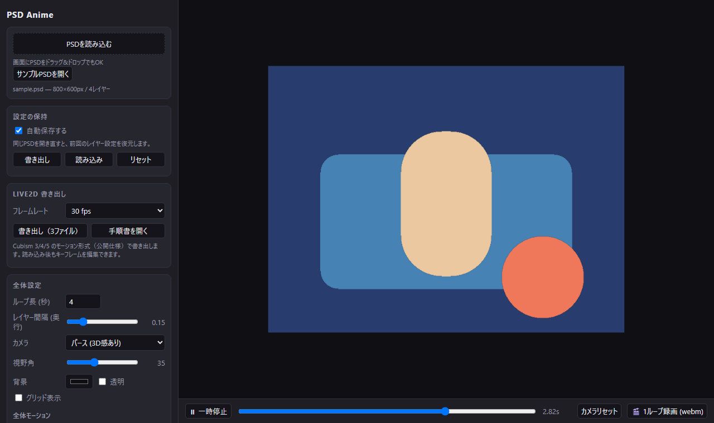

# PSD Anime

PSD を読み込んでレイヤーごとに板ポリ化し、three.js 上で「継ぎ目のないループアニメーション」を
組み立てられるブラウザツールです。回転・3D回転・ふわふわ・振り子などのプリセットを
レイヤー単位／全体で設定でき、1ループぶんを webm として書き出せます。

**デモ: https://tomozow.github.io/PSD_Anime/** （「サンプルPSDを開く」ですぐ試せます）



## 主な機能

- PSD をドラッグ&ドロップするだけでレイヤーを3D空間に配置（奥行き・パララックス付き）
- 回転・3D回転・ふわふわ・振り子・点滅など、継ぎ目なくループするモーションプリセット
- レイヤーごとにエフェクトを2つまで重ね掛け、基点・位相ずれ・ランダム度・シードを設定
- 1ループぶんを webm で録画（背景透過も可）
- Live2D 用のモーション（`.motion3.json`）と作業手順書を書き出し
- 設定と直前の PSD を自動保存・復元、JSON で書き出し/読み込み

## 起動

```bash
npm install
npm run dev
```

ブラウザで表示されたURLを開き、PSD をドラッグ&ドロップ（または「PSDを読み込む」）します。

動作確認用のサンプル PSD を作るには:

```bash
node tools/make-sample-psd.mjs
```

`public/sample.psd` が生成されるので、それを読み込んでください。

## 仕組み

- `src/psdLoader.js` — [ag-psd](https://github.com/Agamnentzar/ag-psd) で PSD を解析し、
  グループを再帰展開してレイヤーごとの canvas + 位置を取り出します。
- `src/main.js` — 各レイヤーを `PlaneGeometry` + `CanvasTexture` にして、PSD 上の座標そのままに配置。
  レイヤー順に Z 方向へ並べることで奥行き（パララックス）が出ます。
- `src/presets.js` — アニメーションプリセット。すべて **周期 1.0 の関数**として定義してあるので、
  ループ長を何秒にしても必ず継ぎ目なくループします。また回転は `+=`、スケールと不透明度は `*=`
  で書いてあるため、複数のエフェクトを重ねても壊れません。
- `src/settings.js` — 設定の保存・復元 (localStorage / JSON書き出し・読み込み)。
- `src/store.js` — 直前に開いた PSD 本体を IndexedDB に保持し、リロード時に自動で復元します。

## 設定の保持

- **自動保存** — 値を触るたびに保存されます。ブラウザを閉じて開き直すと、
  **直前に開いていたPSDと、その設定がそのまま復元されます**（PSD本体は IndexedDB に保持）。
- 別のPSDを開いても、レイヤー設定は **PSDごと** に覚えているので混ざりません（レイヤー名で対応付け）。
- **書き出し / 読み込み** — 設定を `.anime.json` として保存・共有できます。
- **リセット** — 現在のPSDの保存済み設定を消して初期状態に戻します。
- 自動保存をオフにすると、保持していたPSDも破棄されます。

## 操作

**全体設定**

| 項目 | 内容 |
| --- | --- |
| ループ長 | 1ループの秒数。すべてのモーションがこの長さに同期します |
| レイヤー間隔 | レイヤー間の Z 方向の距離。大きくすると立体感／パララックスが強くなります |
| カメラ | パース（3D感あり）／平行投影（2Dのまま） |
| 背景 | 背景色。「透明」にすると録画も透過扱いになります（webm の透過対応は環境依存） |
| 全体モーション | シーン全体にかけるモーション |

**レイヤーごと**

行をクリックで展開。**エフェクトは1レイヤーに2つまで重ねられます**（例: Z軸回転 + 点滅）。
各エフェクトごとに モーション、強さ、周期数（1ループ中の往復回数）、位相ずれ（レイヤーを
少しずつずらすと生き生きします）を、レイヤー単位で 基点（回転の中心）、奥行き、不透明度を設定できます。

**基点** は回転・拡大縮小の中心です。

| 基点 | 内容 |
| --- | --- |
| レイヤー中央 | そのレイヤー自身の中心。その場で回ります |
| **画像の中心軸** | PSDキャンバスの中心。レイヤーが画像中心のまわりを **公転** します（魔法陣など） |
| レイヤー下端／上端／左端／右端 | 端を支点にした振り子・開閉などに |

点滅系は3種類あります。

| プリセット | 内容 |
| --- | --- |
| 点滅 (オン/オフ) | 矩形波でパッ／パッと切り替わる。強さ1.0で完全に消えます |
| 明滅 (なめらか) | サインカーブでふわっと明滅します |
| ちらつき (不規則) | 複数の波を重ねた不規則な明滅（蛍光灯・炎など） |

### ランダム度とシード

各エフェクトの **ランダム度** を上げると、波形が不規則になります。
点滅なら「点いている長さ・消えている長さ」がバラつき、明滅ならゆらぎ方が不規則になり、
ちらつきならより細かくなります。ゆらぎ系（上下ふわふわ・振り子・3Dゆらぎ・左右スライド）にも効きます。

**シード** を変えると別のランダムパターンになります（「引き直す」ボタンでランダムに選び直し）。
同じシードなら毎回まったく同じ動きになるので、結果は完全に再現できます。

ランダムといっても、内部では **整数倍音の正弦波だけを合成した「周期1に閉じたノイズ」** を使っているため、
どれだけランダム度を上げても継ぎ目なくループします（`u=0` と `u=1` の状態が厳密に一致することを確認済み）。

**ビューポート**

- ドラッグで回転、ホイールでズーム、右ドラッグでパン
- 下部のシークバーで任意のフレームを確認
- 「1ループ録画」で、ちょうど1ループぶんを webm でダウンロード

## Live2D 書き出し

サイドバーの「Live2D 書き出し」から、次の3ファイルを書き出します。
Cubism Animator に読み込んだあともキーフレームを編集できます。

| ファイル | 内容 |
| --- | --- |
| `<名前>.motion3.json` | Cubism 3/4/5 のモーション（公開仕様） |
| `<名前>_live2d_setup.html` | **パーツごと**に分けた作業手順。ブラウザで開くと表が崩れずに読めます |
| `<名前>_live2d_params.csv` | パラメータ一覧（Excel用。BOM付きUTF-8） |

手順書は「1パーツ = 1セクション」の構成で、そのパーツで作るデフォーマ・パラメータ・
打つキーフォームの値と**その値で作る形**（例:「回転デフォーマを90度回す」「横幅を1.41倍」）まで
個別に書き出します。「手順書を開く」ボタンでその場で開けます。

- **不透明度**（点滅・明滅・ちらつき）→ `PartOpacity` カーブ。PSD読み込みで作られるパーツIDに
  **そのまま効く**ので設定不要です。
- **移動・回転・拡大縮小** → `Parameter` カーブ。移動は px、回転は度で実寸そのまま。
  伸縮系だけは Live2D で扱いやすいよう **-1〜1（0が等倍）** に正規化し、実際の倍率は
  キーフォームの指示文（「縦横まとめて1.41倍」など）に出します。
  縦横が連動している場合は1本にまとめます（同倍率なら `Scale`、横に伸びると縦が縮むなら `ScaleXY`）。
  本当に独立している場合だけ `ScaleX`/`ScaleY` に分かれ、手順書に
  「ワープデフォーマを2重にして外側=縦・内側=横」と出ます。
  `.motion3.json` が持つのは**パラメータ値の時間変化だけ**なので、モデル側にキーフォームが必要です。
  手順書には「どのパラメータ値でキーを打つか」まで出力します。
  - 回転はキーフォーム間が頂点位置の直線補間になるため、**45度以内**の刻みでキー値を出します
    （2キーだけだと弧を描かず中心に潰れます）。
  - 1ループで回りきる回転は **0〜360のノコギリ波**に折り返して出力するので、キーフォームは
    0/90/180/270/360 の5点で済み、何周でも継ぎ目なく回ります（360は0と同じ形にする）。
- カーブは Cubism ネイティブの **ベジェセグメント**で当てはめるので、キー数が最小限に収まります
  （例: 12秒/30fps の連続回転 = 361サンプル → **2キー**）。点滅のような矩形波は **ステップセグメント**になります。
- `Loop: true` 付きで出力します。

`.cmo3` / `.can3` は非公開フォーマットのため生成できません。モデル自体は Cubism Editor で
PSDを直接読み込んでください（このツールはアニメーション部分を受け持ちます）。

## メモ

- レイヤーの `hidden`（PSD 上で非表示）は初期状態で非表示になります。
- 統合済み（レイヤーのない）PSD は読み込めません。
- `window.psdAnime` にデバッグ用の最小 API（`state` / `openFile` / `openUrl`）を公開しています。
